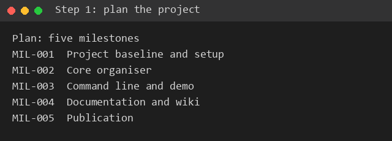
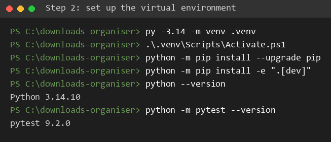
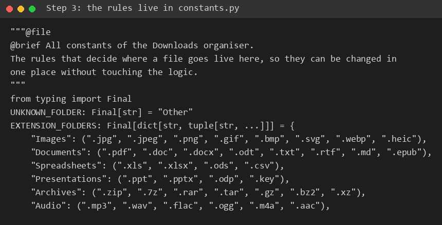
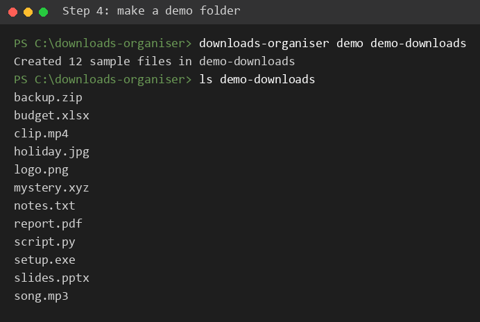
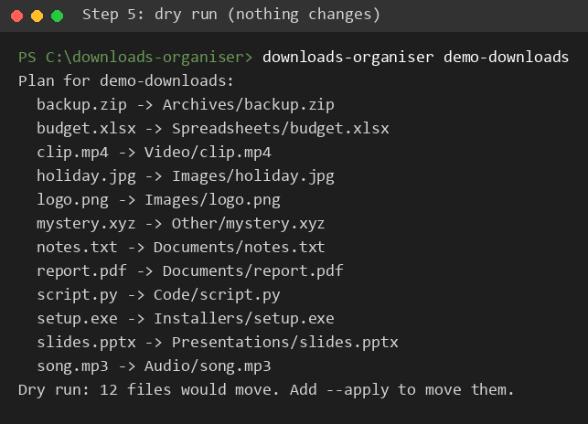
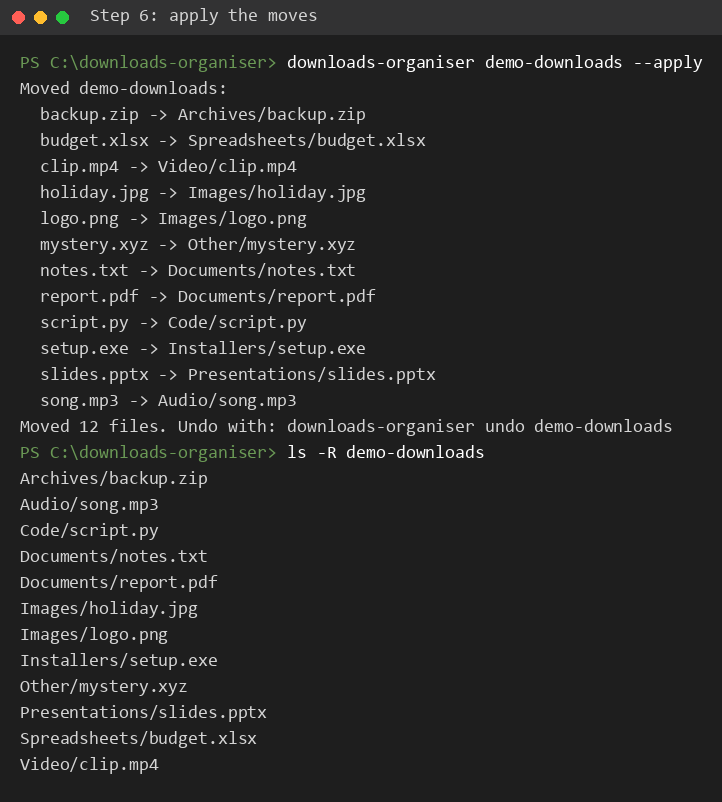
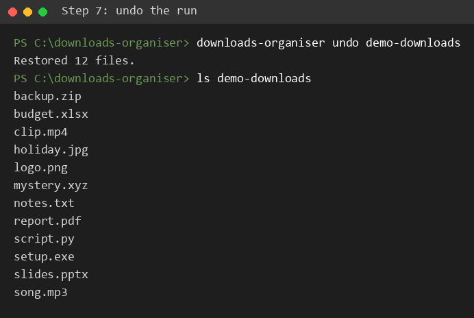
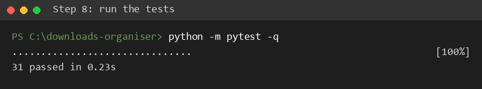

# 🚀 Downloads organiser

A small command line tool that sorts the files of a folder, for example your Downloads folder, into sub-folders by file type. It is a solution to Day 98 (Custom Automation) of the Udemy course "100 Days of Code: The Complete Python Pro Bootcamp", made for fellow course participants and for anyone looking for ideas.

## 📚 Table of Contents

- [Overview](#-overview)
- [Requirements](#-requirements)
- [Setup](#-setup)
- [Run](#-run)
- [Tests](#-tests)
- [License](#-license)
- [Links](#-links)
- [Appendix: Project documents](#-appendix-project-documents)

## 🧭 Overview

The tool looks at the files directly inside one folder and moves each one into a sub-folder chosen by its extension (`Images`, `Documents`, `Archives` and so on). It is built to be safe:

- **Dry run by default.** It prints what it would do and changes nothing until you pass `--apply`.
- **Undo.** Every applied run writes an undo log, and one command moves the files back.
- **No overwriting.** If a file with the same name already exists in the target folder, the new file gets a number: `photo (1).jpg`.

It uses only the Python standard library, so there is nothing to install besides Python itself.

| Part | What it is for |
| --- | --- |
| `src/downloads_organiser/` | The package: `domain` (the rules), `application` (the use cases), `infrastructure` (file system), `presentation` (command line), and `constants.py` (all constants) |
| `tests/` | The pytest tests |
| `docs/` | Project documents, screenshots and the wiki |
| `Doxyfile` | Configuration for the Doxygen API documentation |

## 📋 Requirements

- Python 3.14 or later, to run the tool and the tests.
- `venv`, which comes with Python, to keep the tools of this project apart from the rest of your system.
- Doxygen, only if you want to build the API documentation.

## 🛠️ Setup

Create a local virtual environment named `.venv` in the project folder, activate it, upgrade pip and install the project with its test tools.

Windows (PowerShell):

```powershell
py -3.14 -m venv .venv
.\.venv\Scripts\Activate.ps1
python -m pip install --upgrade pip
python -m pip install -e ".[dev]"
```

Linux and macOS:

```bash
python3.14 -m venv .venv
source .venv/bin/activate
python -m pip install --upgrade pip
python -m pip install -e ".[dev]"
```

Leave the environment with `deactivate`. Delete the `.venv` folder to remove it; nothing outside the project is changed.

## ▶️ Run

With the virtual environment active, make a demo folder, look at the plan, apply it and undo it:

```bash
downloads-organiser demo demo-downloads
downloads-organiser demo-downloads
downloads-organiser demo-downloads --apply
downloads-organiser undo demo-downloads
```

Without a folder the tool uses your own `Downloads` folder, so start with the dry run:

```bash
downloads-organiser
```

The same functions are available from Python, using the names of the assignment:

```python
from downloads_organiser import organise_folder, undo_last_run

organise_folder("demo-downloads")               # dry run: returns the planned moves
organise_folder("demo-downloads", apply=True)   # moves the files
undo_last_run("demo-downloads")                 # moves them back
```

Folders: `Images`, `Documents`, `Spreadsheets`, `Presentations`, `Archives`, `Audio`, `Video`, `Installers`, `Code` and `Other`. The rules are in `src/downloads_organiser/constants.py`. Hidden files, unfinished downloads and sub-folders are left alone.

### Lecture steps

The screenshots are made from the real output of the tool by `docs/tools/make_screenshots.py`. The [wiki][wiki] explains what each step taught, in English, Danish and Bahasa Malaysia.

#### Step 1: Plan the project

Decide the safety rules first: dry run, undo, never overwrite.



#### Step 2: Set up the environment

A local `.venv`, an upgraded pip and one `pyproject.toml`.



#### Step 3: Keep the rules in constants.py

The table of folders and extensions lives in one place.



#### Step 4: Make a demo folder

Made-up sample files, so no private names are ever shown.



#### Step 5: Dry run

The default run prints the plan and changes nothing.



#### Step 6: Apply the moves

`--apply` moves the files and writes the undo log.



#### Step 7: Undo the run

`undo` moves every file of the last run back.



#### Step 8: Run the tests

pytest on temporary folders is the safety net.



## 🧪 Tests

With the virtual environment active:

```bash
python -m pytest
```

The code is checked with `ruff check`, `ruff format --check` and `mypy`. The API documentation is built with `doxygen Doxyfile` and written to `docs/doxygen/html`.

### Security scan

Before every push the repository is scanned with opengrep (the pull request check runs the same tool with the organisation rule set):

```powershell
& "$HOME\.opengrep\cli\latest\opengrep.exe" scan --config auto --exclude framework --error .
```

## 📄 License

The project is licensed under the GNU Affero General Public License version 3, see [LICENSE][license].

## 🔗 Links

- [Repository][repository]
- [Documentation][documentation]
- [Issue tracker][issues]

## 📎 Appendix: Project documents

The documents a newcomer needs, in reading order.

| Document | What it tells you |
| --- | --- |
| [Business Case][BC-001] | Why the project exists, its scope and success criteria |
| [Stakeholder Analysis][SA-001] | Who is involved; the stakeholder IDs used for owners and reviewers |
| [Project Plan][PP-001] | The gateways and their schedule |
| [Milestones][milestones] | One document per gateway: Go/No-Go criteria and tasks |
| [Artifact registry][registry] | Where each artifact type lives, the next version, the PO language and domain |
| [Framework README][framework-readme] | The framework this project uses |

---

[repository]: https://git.tirsystem.com/Tirsvad-Udemy-100-days-of-code/098-assignment-custom-automation
[documentation]: https://git.tirsystem.com/Tirsvad-Udemy-100-days-of-code/098-assignment-custom-automation/wiki
[wiki]: https://git.tirsystem.com/Tirsvad-Udemy-100-days-of-code/098-assignment-custom-automation/wiki
[issues]: https://git.tirsystem.com/Tirsvad-Udemy-100-days-of-code/098-assignment-custom-automation/issues
[license]: ./LICENSE
[BC-001]: ./docs/business-case.md
[SA-001]: ./docs/stakeholder-analysis.md
[PP-001]: ./docs/project-plan.md
[milestones]: ./docs/milestones/
[registry]: ./docs/artifact-registry.md
[framework-readme]: ./framework/README.md
