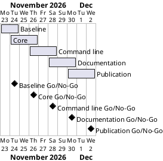

# Project Plan

## Metadata
| Key | Value |
| --- | --- |
| ID | PP-001 |
| CrossReference | [BC-001], [SA-001], [MIL-001], [MIL-002], [MIL-003], [MIL-004], [MIL-005] |
| Language | en |
| Domain | it |

## Version History
| Date | Status | Author | Reviewer | Change | Commit |
| --- | --- | --- | --- | --- | --- |
| 2026-11-23 | Accepted | Jens Tirsvad Nielsen | S01 | Initial version | [7e8885e] |

---

## Purpose

This plan schedules the five gateways of the Downloads organiser from 2026-11-23 to 2026-12-02. It fits the Business Case constraint of a small, time-boxed course assignment (about 120 minutes of coding effort, plus documentation).

## Planning Assumptions

- The plan starts on 2026-11-23 and ends on 2026-12-02 (source: Constraints in [BC-001]).
- Each gateway lasts two to three days; S01 is the only owner and approver (source: [SA-001]).
- Every task is a plain technical task: the tool has one actor, S01, and the rules are small enough that the tasks cite the Business Case objectives instead of separate use cases.
- Work is delivered one pull request per milestone, each closing its issues.

## Gateway Schedule

| Gateway | Document | Window | Decision date | Owner | Stories | Main deliverable | Milestone |
| --- | --- | --- | --- | --- | --- | --- | --- |
| Project baseline and setup | [MIL-001] | 2026-11-23 to 2026-11-24 | 2026-11-24 | S01 | none (technical tasks) | Configuration, tooling, venv instructions | |
| Core organiser | [MIL-002] | 2026-11-24 to 2026-11-26 | 2026-11-26 | S01 | none (technical tasks) | Domain, application and infrastructure with unit tests | |
| Command line and demo | [MIL-003] | 2026-11-26 to 2026-11-28 | 2026-11-28 | S01 | none (technical tasks) | Command line, assignment function names, demo generator | |
| Documentation and wiki | [MIL-004] | 2026-11-28 to 2026-11-30 | 2026-11-30 | S01 | none (technical tasks) | README, Doxygen, wiki in en, da and ms, screenshots | |
| Publication | [MIL-005] | 2026-11-30 to 2026-12-02 | 2026-12-02 | S01 | none (technical tasks) | Scanned repository with description and topics | |



## Scope Coverage

| Business Case scope item | Gateway |
| --- | --- |
| Sorting by extension, rules in `constants.py` | [MIL-001], [MIL-002] |
| Dry run, apply, undo, name clash rule | [MIL-002] |
| Command line interface, unit tests, Doxygen comments, `Doxyfile` | [MIL-003], [MIL-004] |
| README, wiki (en, da, ms), screenshots | [MIL-004] |
| Repository description and topics | [MIL-005] |

## Dependencies

```
MIL-001 → MIL-002 → MIL-003 → MIL-004 → MIL-005
```

A No-Go on a gateway moves every later gateway and the end date by the days needed to fix it. S01 decides the move of the end date and records it as a new Version History row.

## Plan Risks

| Risk | Impact | Mitigation |
| --- | --- | --- |
| Three wiki languages take longer than planned | Documentation gateway slips | Write the English pages first and translate page by page; the screenshots are shared by all languages (from the Business Case risk on documentation) |
| Python 3.14 behaves differently from the tested version | Tests fail late | Run the tests on 3.14 from the first gateway |
| A finding from the opengrep scan needs a code change late | Publication gateway slips | Scan after each milestone, not only before the last push |

## Open Issues

- None.

---

[BC-001]: ./business-case.md
[SA-001]: ./stakeholder-analysis.md
[MIL-001]: ./milestones/mil-001-baseline.md
[MIL-002]: ./milestones/mil-002-core-organiser.md
[MIL-003]: ./milestones/mil-003-command-line.md
[MIL-004]: ./milestones/mil-004-documentation.md
[MIL-005]: ./milestones/mil-005-publication.md
[7e8885e]: https://git.tirsystem.com/Tirsvad-Udemy-100-days-of-code/098-assignment-custom-automation/commit/7e8885e982ea8d7edaf1e9ef37b1154799251620
